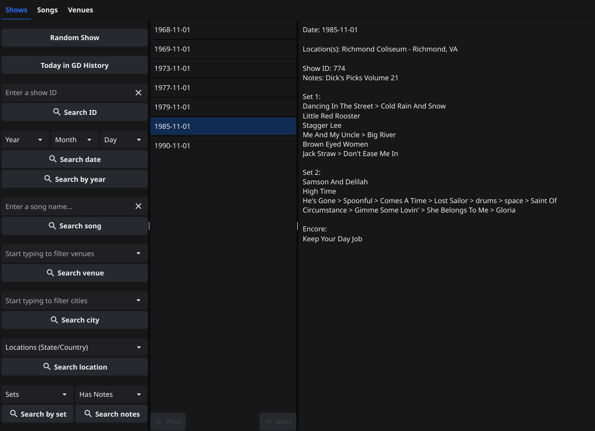
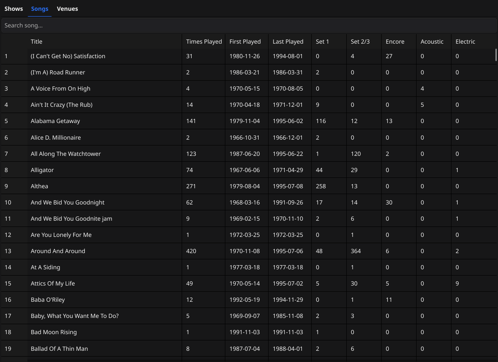
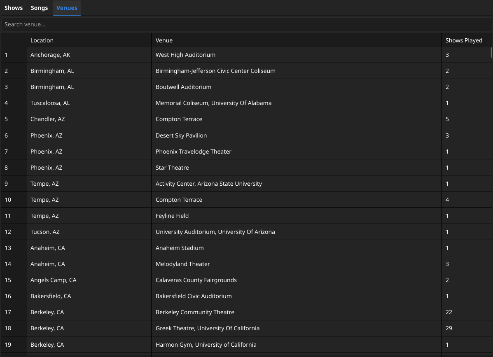

# Deadabase

[](https://go.dev/)[](https://www.postgresql.org/)[](https://www.docker.com/)[](LICENSE)

Deadabase is a REST API for browsing and exploring Grateful Dead concert history.
Search through thousands of shows by date, venue, song, or set name - with full
setlists and show footnotes. A data importer script populates the database from
a JSON source. The API server then provides read-only access to the data.

Show data was sourced from [Grateful Sets](https://www.gratefulsets.net/).
Many thanks to them for this wonderful data!

## Features

- **Fuzzy search** for shows by venue or song name - partial names work
- Browse full setlists with **set positions** (Set 1, Set 2, Encore, etc.)
- **Song footnotes** - annotations for notable moments like song debuts or
  first-time performances
- Filter shows by **date range**, **set name**, **year**, **state/country**, or
  whether they include **show notes**
- **Song statistics** - times played, first and last performance dates
- Most played songs across all shows or filtered by **set name**
- Unique song counts **per city**

## Tech Stack

- **Go:** HTTP server + [Fyne](https://fyne.io) GUI
- **PostgreSQL:** persistent data storage
- **goose:** database migrations
- **sqlc:** type-safe SQL query generation
- **Docker:** package dependencies together and make setup a simple command

## Local Setup

1. Clone the repo

   ```bash
   git clone https://github.com/LunarDrift/gddb
   cd gddb
   ```

2. Edit the `.env.example` file with your own details and rename it to `.env`

   **Note**: The _Today in GD History_ feature uses the database's current date.
   Set your time zone in the `DB_URL` using an IANA name such as `America/New_York`
   or `Europe/London` (see the [list of tz database timezones](https://en.wikipedia.org/wiki/List_of_tz_database_time_zones)).
   If omitted, the database server's default is used (UTC in Docker).

   ```text
   # Database Credentials
   POSTGRES_USER=your_user
   POSTGRES_PASSWORD=your_password
   POSTGRES_DB=your_db_name

   # Internal Docker Connection URL
   DB_URL=postgres://your_user:your_password@db:5432/your_db_name?sslmode=disable&timezone=your_timezone
   ```

3. Run the docker command

   ```bash
   docker compose up --build
   ```

   Use `--build` on first run or after any change to the Go source or Dockerfile,
   so `docker-compose` rebuilds the `deadabase:local` app image before starting
   the containers.

## GUI Client

After spinning up the database + API server in Docker, `go run ./cmd/gui` will
launch the GUI client with various show search methods, a table of all song stats,
and a table of all venue stats. The initial launch may take a few moments for
Fyne to build/compile.





## API Endpoints (GET only)

Many query parameters can be combined to filter shows in a single search.
For example, `/shows?year=1978&location=NY&has_notes=true` returns a filtered
list of shows from 1978 played in New York, that has show notes attached.

_Note: `/shows?date=`, `/shows?id=`, `/shows?start_date=&end_date=` cannot be combined
with anything._

For further details about each endpoint and their response shapes,
take a look at the [wiki](https://github.com/LunarDrift/gddb/wiki).

| ENDPOINT                            | DESCRIPTION                                                                                                           |
| ----------------------------------- | --------------------------------------------------------------------------------------------------------------------- |
| `/shows`                            | Paginated list of all shows played                                                                                    |
| `/shows?id=`                        | Search for a specific show by its ID                                                                                  |
| `/shows?date=`                      | Search for a show by date (YYYY-MM-DD)                                                                                |
| `/shows?start_date=&end_date=`      | List of shows between two dates (YYYY-MM-DD)                                                                          |
| `/shows?song=`                      | Search for shows where a specific song was played. Returns a list of shows                                            |
| `/shows?set_name=`                  | Search for shows by set name<br>(`set_1`, `set_2`, `set_3`, `encore`, `acoustic`, `electric`)                         |
| `/shows?venue=`                     | Search for shows by venue.                                                                                            |
| `/shows?has_notes=true/false`       | Search for shows with/without show notes                                                                              |
| `/shows?year=&month=&day=`          | List of shows filtered by date. E.g. all shows played on the 15th in 1978                                             |
| `/shows?location=`                  | List of shows filtered by location<br>(states or country names. states should be the standard 2 letter abbreviations) |
| `/shows?city=`                      | List of shows filtered by city                                                                                        |
| `/shows?notes=`                     | List of shows filtered by show notes query                                                                            |
| `/shows/random`                     | Get details for a random show                                                                                         |
| `/shows/today`                      | List of shows played on today's date                                                                                  |
| `/shows/acoustic`                   | List of all acoustic shows                                                                                            |
| `/shows/song-debuts`                | List of shows with song debuts                                                                                        |
| &nbsp;                              | &nbsp;                                                                                                                |
| `/songs?sort=most_played`           | Returns a list of all songs and the amount of times they were played                                                  |
| `/songs?venue=`                     | All songs played at a specific venue                                                                                  |
| `/songs?played_lt=n`                | Songs played less than `n` times                                                                                      |
| `/songs?sort=most_played&set_name=` | Most played songs by set name (set_1, set_2, set_3, encore, acoustic, electric)                                       |
| `/songs/{name}`                     | Stats for a song (times played, first/last time played)                                                               |
| &nbsp;                              | &nbsp;                                                                                                                |
| `/stats/songs-per-city`             | Unique song count per city                                                                                            |
| `/stats/songs`                      | List of all songs and how many times they were played in each set                                                     |
| `/stats/venues`                     | List of all venues and how many shows were played there                                                               |
| &nbsp;                              | &nbsp;                                                                                                                |
| `/references/locations`             | List of all valid locations (state abbreviations & country names)                                                     |
| `/references/cities`                | List of all valid cities                                                                                              |
| `/references/venues`                | List of all valid venues                                                                                              |

## Rate Limiting

Requests are limited per IP address to **2 requests/second** (burst up to 10).
Exceeding this returns a `429 Too Many Requests`

## Example Single Show Response

```json
{
  "show_id": 147,
  "date": "1993-03-14",
  "venue": "Richfield Coliseum",
  "city": "Richfield",
  "location": "OH",
  "notes": "",
  "sets": [
    {
      "set_name": "set_1",
      "songs": [
        "Cold Rain And Snow",
        "Walkin' Blues",
        "Brown Eyed Women",
        "Just Like Tom Thumb's Blues",
        "Lazy River Road",
        "Eternity > Don't Ease Me In"
      ]
    },
    {
      "set_name": "set_2",
      "songs": [
        "Touch Of Grey",
        "Samson And Delilah",
        "Way To Go Home",
        "Corrina > Terrapin Station > drums > space > I Need A Miracle > Stella Blue > Throwing Stones > Turn On Your Lovelight"
      ]
    },
    {
      "set_name": "encore",
      "songs": ["I Fought The Law *"]
    }
  ],
  "footnotes": {
    "*": "First time played"
  }
}
```

## Example Paginated Response

```json
{
  "count": 271,
  "next": "/shows?limit=3&offset=6&song=althea",
  "previous": "/shows?limit=3&offset=0&song=althea",
  "results": [
    {
      "show_id": 1199,
      "date": "1979-08-13",
      "venue": "McNichols Sports Arena",
      "city": "Denver",
      "location": "CO",
      "notes": ""
    },
    {
      "show_id": 1197,
      "date": "1979-08-31",
      "venue": "Glens Falls Civic Center",
      "city": "Glens Falls",
      "location": "NY",
      "notes": ""
    },
    {
      "show_id": 1192,
      "date": "1979-09-06",
      "venue": "Madison Square Garden",
      "city": "New York",
      "location": "NY",
      "notes": ""
    }
  ]
}
```

## Notes

- Venue and song name searches use fuzzy matching - partial names work
- Shows without a recorded setlist return a custom `message` field instead of `sets`
- `footnotes` in show responses are keyed by marker symbol (e.g. `"*": "First time played"`)
- `location` can either be a state abbreviation (NY, CA, etc) or a country name (England, Spain, etc). Case-insensitive

## TODO

- Continue adding/improving unit tests
- ~Server logging~
- Keep learning

## A Note on AI Usage

This project's code and queries were written by me. I used LLMs sparingly as a
study aid - discussing concepts and query decisions, and occasionally help
debugging. No AI generated code was used - with the exception of the
`docker-compose` file which I had a lot of help with from Claude.

## Credits

Show and setlist data sourced from [Grateful Sets](https://www.gratefulsets.net/)

## License

This project is licensed under the MIT license - see the [LICENSE](LICENSE) file
for details.
